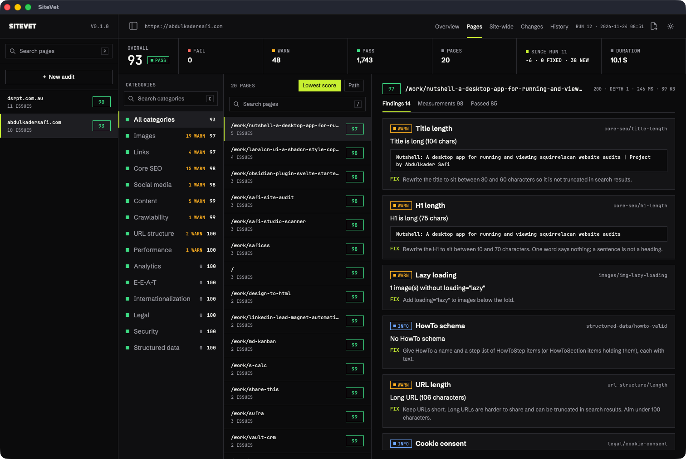
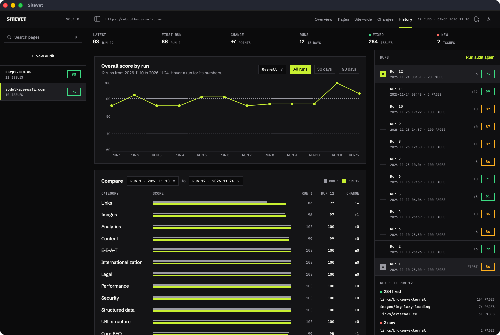

# SiteVet desktop

A desktop app for [sitevet](https://crates.io/crates/sitevet), the Rust website audit engine. It runs audits on your machine, shows the results page by page, and keeps every run in the same history database the `sitevet` CLI uses, so runs from either one show up in both.

Built with GPUI through [GPUI Kit](https://gpui-kit.com) (`gpui-kit` 0.11). The score chart is GPUI Kit's own `LineChart`.





## Download

Get the installer for your system from [Releases](https://github.com/Abdulkader-Safi/SiteVet-DesktopAPP/releases): a `.dmg` for macOS (Apple silicon), a `-setup.exe` for Windows, or an `.AppImage` for Linux.

The builds are not code-signed yet. On macOS, open System Settings, Privacy & Security and click "Open Anyway" the first time, or run `xattr -dr com.apple.quarantine /Applications/SiteVet.app`. On Windows, click "More info" and then "Run anyway" when SmartScreen stops it.

When a newer release is out, the app shows a small card in the bottom-right corner on start. Download opens the installer for your system in the browser.

## What works

- New audit for one site, or a list of sites run two (or any number) at a time.
- Live progress: pages as they finish with their scores, running check counts, elapsed time, and a cancel button. A batch gets its own table with a row per site.
- The report for each site, in five tabs. Pages lists every page worst first, with its findings and measurements. Overview shows each category's score. Site-wide holds the findings that compare pages (duplicates, orphans). Changes lists what was fixed and what is new since the last run.
- History: score by run on a chart, a side-by-side compare of any two runs per category, and the rules fixed or broken between them.
- Dark and light themes. The app follows the system until you click the switch in the top bar.
- Settings (the gear in the top bar) shows the app version and links, and holds the audit defaults: limits, checks and every other option. New audits start from them. A value changed on the new audit form applies to that audit only, and Reset to defaults puts the saved values back. They are kept in `desktop-defaults.toml`, next to the history database.
- Keyboard: `P` jumps to the site search. On the Pages tab, `C` searches categories and `/` searches pages.

Export (the file icon in the report's top bar) saves the open run as an HTML report, Markdown or JSON. Pick a format, choose where to save it, and a card in the bottom-right corner opens the file or shows it in Finder. The HTML file opens in any browser and prints to PDF; the Markdown pastes into Word, Google Docs or an email.

## Run from source

You need Rust 1.100 or newer. `rust-toolchain.toml` pins it, so rustup installs it on the first build. GPUI's macOS crate uses `Option::map_or_default`, which older compilers reject.

```sh
cargo run --release
```

Or install the binary without cloning:

```sh
cargo +1.100.0 install --git https://github.com/Abdulkader-Safi/SiteVet-DesktopAPP --locked
sitevet-desktop
```

Rendered checks (axe-core and Core Web Vitals) need Chrome installed. Turn them on under Checks in the new audit form.

## Where your data lives

History is `history.db` in the OS data folder: `~/Library/Application Support/sitevet` on macOS, `~/.local/share/sitevet` on Linux, `%APPDATA%\sitevet` on Windows. Set `SITEVET_HOME` to use another folder, which is handy for trying the app without touching your real runs.

## Known gaps

The "Check external links" switch removes the `links/broken-external` rule from the run, so those results no longer appear. The SDK's link checker still sends its HEAD requests to external links either way, because `sitevet::Options` has no setting to skip them.

## Layout

```text
src/
  main.rs        window setup
  app.rs         state, the audit engine, site list and top bar
  data.rs        history, settings and counts over the SDK (no UI code; has tests)
  theme.rs       colour tokens, type scale and fonts from the Figma file
  ui.rs          shared components: score chip, status badge, buttons, fields
  editor.rs      the audit options editor shared by New audit and Settings
  export.rs      the export menu, save dialog and result card
  screens/       report, history, new audit, progress, settings
assets/
  fonts/         Schibsted Grotesk, JetBrains Mono, Saira Stencil One (OFL)
  icons/         the design's SVG icons
  app/           the app icon (app-icon.svg and the files made from it)
```

```sh
cargo test
cargo clippy --all-targets -- -D warnings
```

## Build a release

```sh
cargo install cargo-packager --version 0.11.8 --locked
cargo install cargo-about --locked --features cli
cargo about generate about.hbs -o THIRD_PARTY_LICENSES.html
cargo packager --release -c Packager.toml
```

This makes a `.app` and `.dmg` on macOS, an NSIS installer on Windows and an AppImage on Linux, in `dist/`.

To publish one, add a `## vX.Y.Z` section to `docs/releases.md`, bump `version` in `Cargo.toml` and `Packager.toml`, commit, then push a tag: `git tag v0.1.0 && git push origin v0.1.0`. GitHub Actions builds on all three systems and attaches the installers to a release, with that section of `docs/releases.md` as its notes.

The app icon comes from `assets/app/app-icon.svg`. After editing it, run `scripts/app-icon.sh` to rebuild the `.icns`, `.ico` and `.png`.

## Licence

SiteVet is MIT licensed (see `LICENSE`). The fonts in `assets/fonts` are under the SIL Open Font License; their licence files sit beside them.
